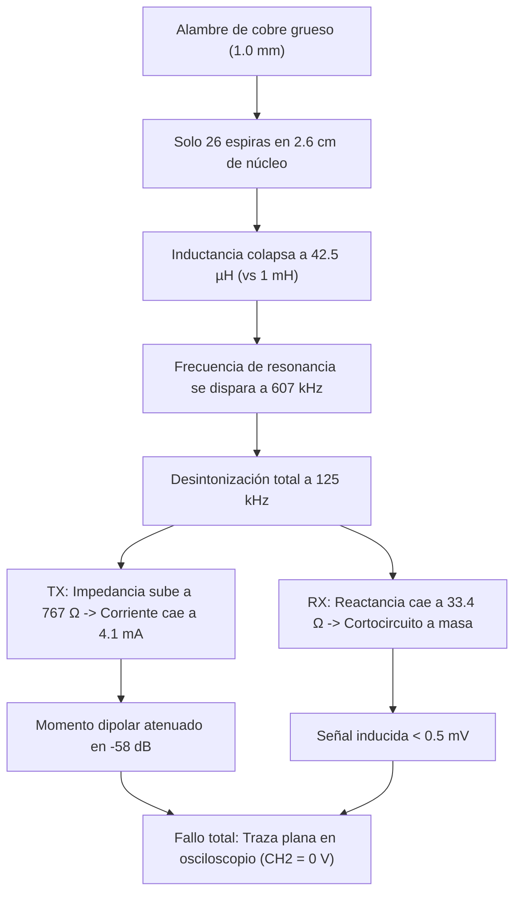
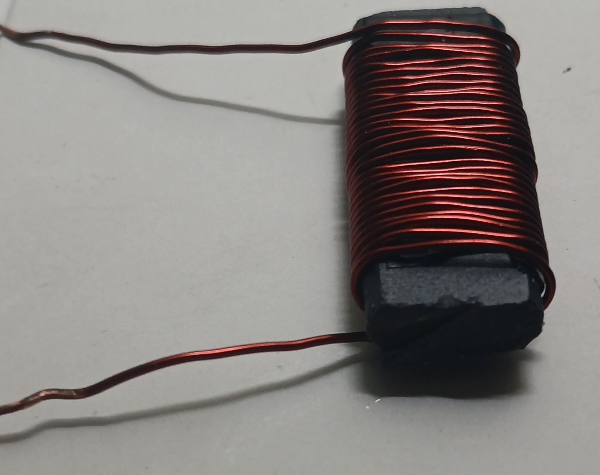
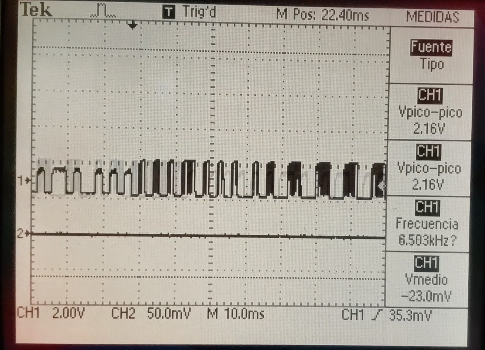
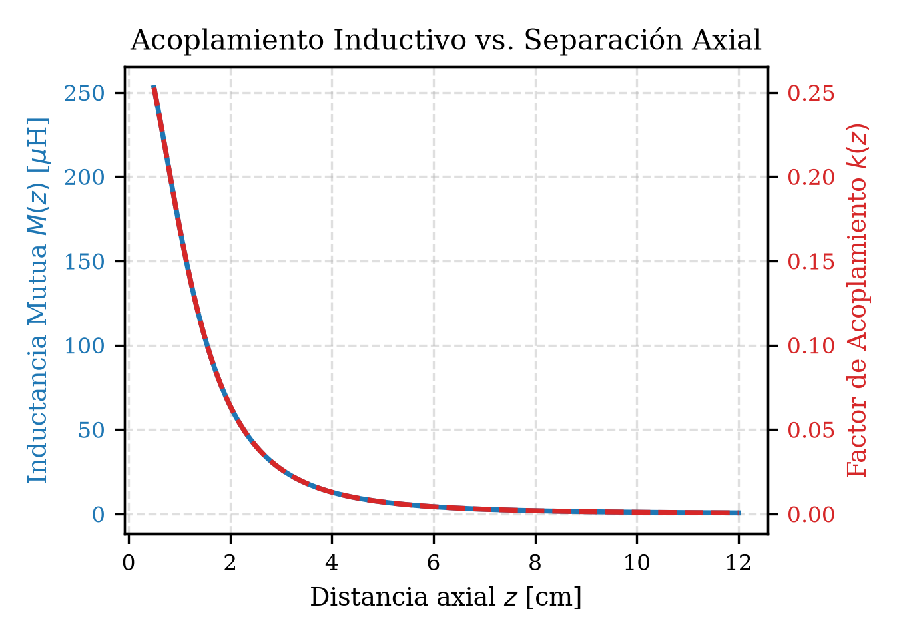
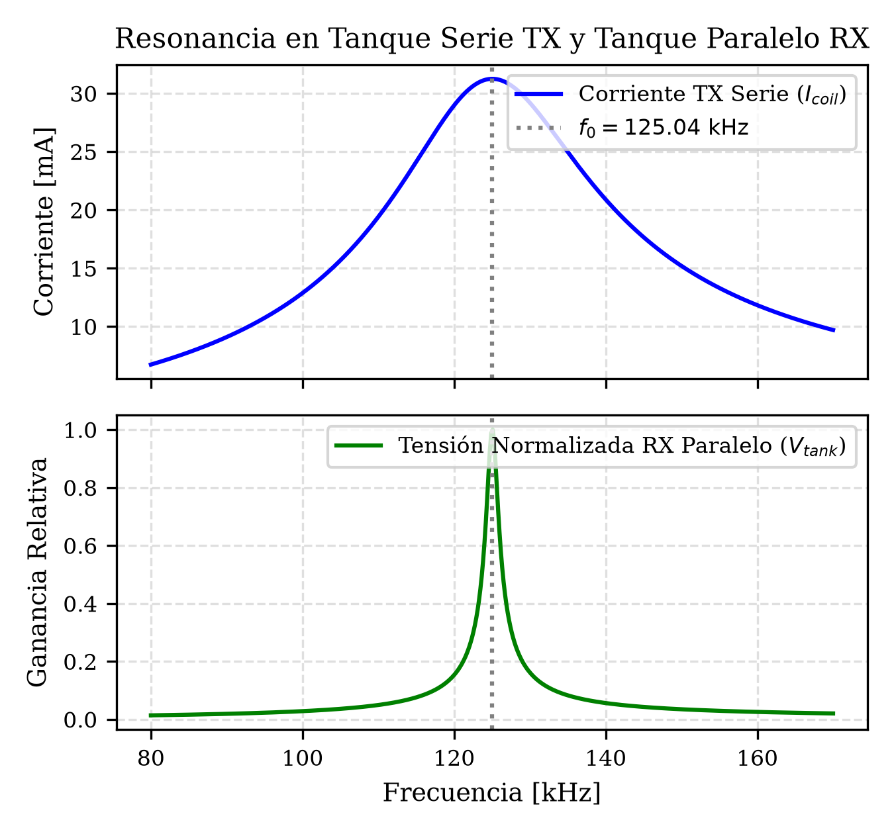
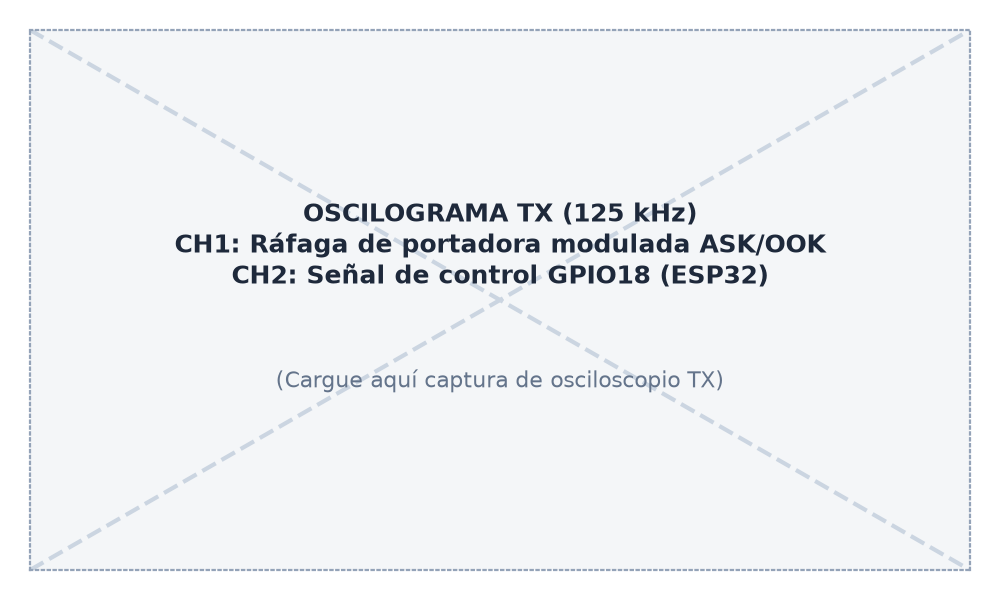
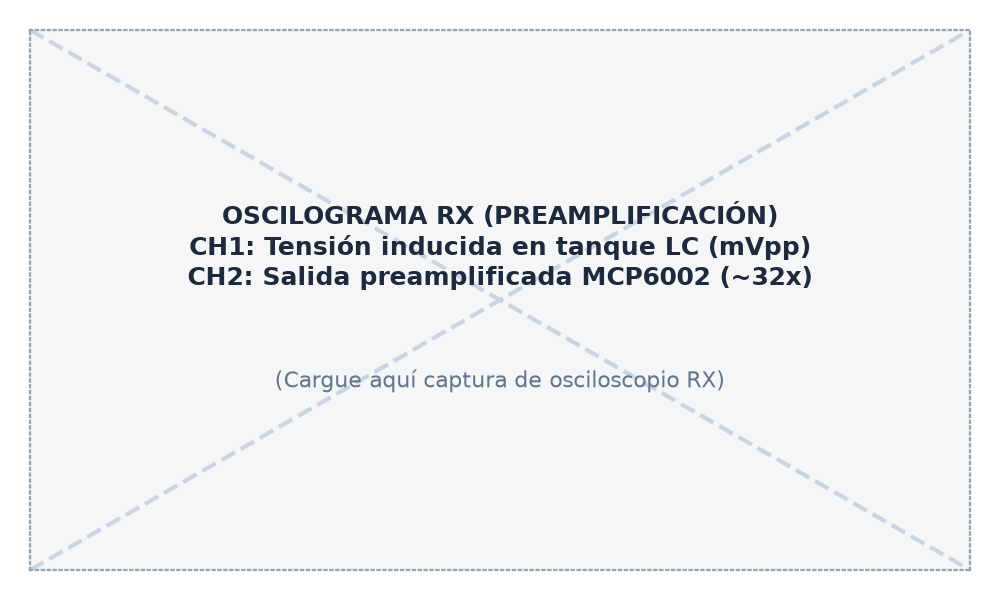

# Diseño, Simulación, Validación Analítica y Evaluación Experimental de un Enlace de Comunicación Inductiva a 125 kHz con Modulación ASK/OOK

**Formato IEEE — Informe Consolidado de Proyecto**

---

## 1. Carátula y Resumen Ejecutivo

### Datos Institucionales
* **Título:** Diseño, Simulación, Validación Analítica y Evaluación Experimental de un Enlace de Comunicación Inductiva a 125 kHz con Modulación ASK/OOK
* **Autores:** [Nombre del Estudiante 1], [Nombre del Estudiante 2], [Nombre del Estudiante 3]
* **Filiación:** Departamento de Ingeniería Eléctrica y Electrónica
* **Institución:** [Nombre de la Universidad / Institución Académica]
* **Asignatura:** Campos Electromagnéticos / Teoría Electromagnética
* **Docente / Asesor:** [Nombre del Profesor / Asesor de Cátedra]
* **Fecha de Emisión:** Noviembre 2026

### Resumen
El presente artículo presenta el diseño, simulación, validación analítica y evaluación experimental de un enlace de comunicación inalámbrica de corto alcance fundamentado en inducción magnética cuasiestática a una frecuencia portadora de $125\text{ kHz}$ mediante modulación digital ASK/OOK. El principio físico del enlace reside en la ley de inducción electromagnética de Faraday-Lenz y la ley de Biot-Savart, acoplando dos bobinas en régimen reactivo ($r \ll \lambda / 2\pi$), donde la radiación electromagnética de campo lejano es despreciable. Se desarrolla un modelo cuantitativo completo que deduce la ganancia pasiva por resonancia ($Q$), la ganancia activa de tensión de dos etapas (incorporando las limitaciones impuestas por el producto ganancia-ancho de banda $\text{GBW} = 1.0\text{ MHz}$ del amplificador operacional MCP6002), el balance de potencia activa y reactiva de los nodos de transmisión ($162.74\text{ mW}$) y recepción ($102.45\text{ mW}$), y el presupuesto temporal de modulación para codificación Manchester a $250\text{ bps}$. 

Se presenta además el análisis forense experimental del fallo observado en laboratorio al emplear un inductor casero tipo electroimán (núcleo rectangular de ferrita de $3.5\times 0.5\times 1.3\text{ cm}$ con alambre de cobre grueso de $1.0\text{ mm}$, $N\approx 26-30$ espiras, $L\approx 42.5\,\mu\text{H}$), cuya severa desintonización ($f_0'\approx 607\text{ kHz}$) y reducción del momento dipolar magnético en más de 800 veces ($-57.9\text{ dB}$) causó la anulación absoluta de la señal recibida (traza plana en osciloscopio Tektronix a $50\text{ mV/div}$) e incapacidad de superar la barrera de conducción del diodo Schottky BAT85 ($V_F\approx 0.25\text{ V}$). Tras restituir las bobinas comerciales sintonizadas de $1.0\text{ mH}$, se corroboró la atenuación cúbica ($1/z^3$) logrando una tasa de error de paquete nula ($\text{PER} = 0$) hasta $7.0\text{ cm}$. Se anexan los firmwares base de transmisión/recepción en microcontrolador ESP32 y los scripts de simulación en Python con sus respectivas explicaciones analíticas.

**Palabras clave:** inducción electromagnética, acoplamiento inductivo, ley de Faraday-Lenz, modulación ASK/OOK, RFID LF, presupuesto de enlace, factor de calidad, ganancia-ancho de banda, desintonización resonante, ESP32.

---

## 2. Introducción

La transferencia inalámbrica de información en distancias ultracortas ha adquirido una relevancia fundamental en aplicaciones biomédicas implantables, identificación por radiofrecuencia (RFID), sistemas de acceso seguro y sensores embebidos en entornos hostiles:

1. **Condición de Frontera Cuasiestática:** Para una portadora de $f_0 = 125\text{ kHz}$, la longitud de onda asociada en el espacio libre es:
   $$\lambda = \frac{c}{f_0} = \frac{3\times 10^8\text{ m/s}}{125\times 10^3\text{ Hz}} = 2.4\text{ km}$$
   La frontera del campo cercano reactivo de Rayleigh, definida por el radio de transición:
   $$r_b = \frac{\lambda}{2\pi} \approx 382\text{ m}$$
   demuestra que para separaciones operativas entre $0\text{ cm}$ y $20\text{ cm}$, la relación de distancia verifica con holgura $r \ll \lambda / (2\pi)$. Por consiguiente, los efectos de radiación electromagnética propagada y retardos de fase son despreciables, gobernando el enlace las leyes de la magnetostática y la inducción cuasiestática de Faraday.
2. **Penetración en Medios con Pérdidas:** El campo predominantemente magnético sufre una atenuación drásticamente inferior en presencia de agua, tejidos biológicos y envolventes no ferrosas en comparación con campos electromagnéticos de microondas.
3. **Inmunidad frente a Desvanecimiento:** Nula susceptibilidad a reflexiones multicamino (*multipath fading*) o interferencias destructivas espaciales en recintos apantallados o cerrados.
4. **Costo y Confiabilidad Circuital:** Posibilidad de sintetizar transmisores y receptores de alta confiabilidad con componentes analógicos discretos de precisión comercial y microcontroladores de propósito general (ESP32).

El informe se estructura de la siguiente manera:
* **Sección 3 (Metodología):** Formulación del modelo físico y electromagnético, análisis paramétrico entre la bobina nominal de $1\text{ mH}$ y el electroimán casero de ferrita, arquitectura circuital de TX y RX, y protocolo digital.
* **Sección 4 (Resultados):** Deducciones cuantitativas de ganancia, potencias y rendimiento de trama, evidencia experimental del electroimán y oscilograma Tektronix con fallo de enlace, simulaciones numéricas/SPICE y mediciones nominales.
* **Sección 5 (Discusión y Conclusiones):** Análisis forense de la falla de laboratorio, caracterización exhaustiva de los ruidos electromagnéticos captados (50/60 Hz, SMPS, ESP32, glitches) y sus mitigaciones, límite físico del detector Schottky, conclusiones y trabajo futuro.
* **Sección 6 (Referencias):** Bibliografía bajo estándar IEEE.
* **Apéndices (Anexos Técnicos):** Código fuente completo y explicado del firmware base (TX y RX) previo a periféricos I2C/pantallas, y scripts de simulación en Python.

---

## 3. Metodología

### A. Modelo Físico y Formulación Electromagnética

#### 1. Ley de Biot-Savart y Aproximación Dipolar
Para una bobina circular de radio medio $a$, $N_1$ espiras y corriente armónica $i_1(t)$, la densidad de flujo magnético axial a una distancia $z$ sobre el eje normal al plano de la espira es:
$$B_z(z, t) = \frac{\mu_0 N_1 i_1(t) a^2}{2 (a^2 + z^2)^{3/2}}$$
Para distancias axiales sensiblemente superiores al radio físico de la bobina ($z \gg a$), la expresión converge al modelo de dipolo magnético puntual:
$$B_z(z, t) \approx \frac{\mu_0 m(t)}{2\pi z^3}, \quad m(t) = N_1 i_1(t) \pi a^2$$
demostrando la atenuación geométrica de tercer orden ($1/z^3$) de la densidad de flujo en campo reactivo.

#### 2. Flujo Concatenado, Inductancia Mutua y Factor de Acoplamiento
El flujo magnético concatenado $\Phi_{21}(z, t)$ por una bobina receptora coaxial de $N_2$ espiras y superficie transversal $S_2$ ubicada a distancia $z$ es:
$$\Phi_{21}(z, t) \approx B_z(z, t) \cdot S_2 = \frac{\mu_0 N_1 S_2 a^2}{2 (a^2 + z^2)^{3/2}} i_1(t)$$
Definiendo la inductancia mutua $M(z)$ y el factor de acoplamiento magnético adimensional $k(z)$:
$$M(z) = \frac{N_2 \Phi_{21}(z, t)}{i_1(t)} = \frac{\mu_0 N_1 N_2 S_1 S_2}{2\pi (a^2 + z^2)^{3/2}}$$
$$k(z) = \frac{M(z)}{\sqrt{L_1 L_2}}, \quad 0 \le k(z) < 1$$

#### 3. Fuerza Electromotriz Inducida (Ley de Faraday-Lenz)
$$\mathcal{E}_{\text{ind}}(t) = - M(z) \frac{d i_1(t)}{dt} = \omega_0 M(z) I_{1,\text{pk}} \sin(\omega_0 t)$$

#### 4. Topología Resonante Asimétrica
Para superar la severa atenuación cúbica y optimizar la relación señal a ruido (SNR), ambas etapas se sintonizan a la portadora ($f_0 = 125.04\text{ kHz}$):
* **Transmisor Serie ($L_1$ en serie con $C_{\text{res}}$):** En resonancia ($\omega = \omega_0$), la reactancia se anula ($X_{L1} = X_C$), reduciéndose la impedancia al mínimo puramente resistivo:
  $$Z_{\text{TX}}(\omega_0) = R_{\text{total}} = R_{\text{limit}} + R_{\text{ESR}} + R_{DS(\text{on})} \approx 163.50\,\Omega$$
  lo que maximiza la corriente $I_{\text{pk}}$ inyectada en la bobina para maximizar el momento dipolar.
* **Receptor Paralelo ($L_2$ en paralelo con $C_{\text{res}}$):** Presenta impedancia máxima en resonancia, actuando como un multiplicador pasivo de tensión:
  $$V_{\text{tank}}(\omega_0) \approx Q_0 \cdot \mathcal{E}_{\text{ind}} = \left(\frac{\omega_0 L_2}{R_{\text{ESR}}}\right) \mathcal{E}_{\text{ind}}$$

---

### B. Análisis Paramétrico: Inductor Comercial vs. Electroimán de Laboratorio

Ante la indisponibilidad inicial de inductores comerciales de $1.0\text{ mH}$, se confeccionó en laboratorio un inductor experimental tipo electroimán. Su análisis cuantitativo fundamenta las razones físicas del fallo:

1. **Dimensiones del Núcleo de Ferrita:** Barra rectangular de longitud $\ell_c = 3.5\text{ cm} = 35\text{ mm}$, ancho $w = 0.5\text{ cm} = 5\text{ mm}$ y altura $h = 1.3\text{ cm} = 13\text{ mm}$. Sección transversal magnética:
   $$S_{\text{core}} = 5 \times 13 = 65\text{ mm}^2 = 6.5 \times 10^{-5}\text{ m}^2$$
   Longitud del embobinado: $\ell_w = 2.6\text{ cm} = 26\text{ mm}$. Alambre de cobre esmaltado: $d_{\text{cu}} = 0.1\text{ cm} = 1.0\text{ mm}$ de diámetro.
2. **Restricción de Espiras por Calibre:** Con alambre de $1.0\text{ mm}$, el número de espiras en una sola capa es de apenas:
   $$N_1 \approx \frac{26\text{ mm}}{1.0\text{ mm}} \approx 26\text{ espiras} \quad (26 - 30\text{ espiras efectivas})$$
   frente a las $350 - 500$ espiras de hilo ultrafino (AWG 38-40) de la bobina comercial de $1\text{ mH}$.
3. **Permeabilidad Aparente de Barra:** Debido a la desmagnetización de polos abiertos ($p = \ell_c / d_{\text{eq}} \approx 3.85 \implies D \approx 0.05$):
   $$\mu_{\text{app}} = \frac{\mu_r}{1 + D(\mu_r - 1)} \approx 20$$
4. **Inductancia Obtenida:**
   $$L_{\text{exp}} = \mu_0 \mu_{\text{app}} \frac{N^2 S_{\text{core}}}{\ell_w} \approx (4\pi \times 10^{-7}) (20) \frac{26^2 (6.5\times 10^{-5})}{0.026} \approx 42.5\,\mu\text{H}$$
   Resultando **23.5 veces menor que el valor nominal ($1000\,\mu\text{H}$)**.
5. **Desintonización Resonante:**
   $$f_0' = \frac{1}{2\pi \sqrt{42.5\,\mu\text{H} \times 1.62\,\text{nF}}} \approx 607.4\text{ kHz}$$
   Desplazada en casi medio megahercio respecto a la portadora de $125\text{ kHz}$.
6. **Impedancia Fuera de Resonancia a 125 kHz:**
   $$X_L = \omega L_{\text{exp}} \approx 33.4\,\Omega, \quad X_C = \frac{1}{\omega C_{\text{res}}} \approx 785.6\,\Omega$$
   $$|Z_{\text{TX}}(125\text{ kHz})| = \sqrt{150^2 + (33.4 - 785.6)^2} \approx 767.0\,\Omega \quad (\text{vs } 163.5\,\Omega)$$
   La corriente en el transmisor se desplomó de $19.47\text{ mA}$ a solo $4.15\text{ mA}$.
7. **Colapso del Momento Dipolar Magnético:**
   $$m_{\text{exp}} = N I_{\text{pk}} S_{\text{core}} = 26 \times (4.15\times 10^{-3}) \times (6.5\times 10^{-5}) \approx 7.01 \times 10^{-6}\text{ A}\cdot\text{m}^2$$
   Frente al valor nominal ($m_{\text{nom}} \approx 5.50 \times 10^{-3}\text{ A}\cdot\text{m}^2$), el campo emitido decayó en **más de 780 veces ($-57.9\text{ dB}$)**.
8. **Efecto Cortocircuito en Recepción:** Una bobina de $42.5\,\mu\text{H}$ en paralelo a $125\text{ kHz}$ presenta una reactancia de apenas $33.4\,\Omega$, derivando cualquier señal inducida a tierra y reduciendo la ganancia de calidad a $Q \ll 1$.



---

### C. Topología de Circuitos Hardware


#### Lista de Materiales Críticos (BOM Comparativo)
| Parámetro / Componente | Nominal Diseño | Electroimán Lab. | Unidad |
| :--- | :---: | :---: | :---: |
| **Inductancia ($L$)** | $1.0$ | $0.0425$ | $\text{mH}$ |
| **Número de espiras ($N$)** | $\approx 400$ | $\approx 26-30$ | espiras |
| **Diámetro de alambre ($d_{\text{cu}}$)** | $0.08$ (AWG 40) | $1.0$ (AWG 18) | $\text{mm}$ |
| **Sección magnética ($S$)** | $\approx 70.7$ (circular) | $65.0$ (rectangular) | $\text{mm}^2$ |
| **Capacitor de sintonía ($C_{\text{res}}$)** | $1.62$ | $1.62$ | $\text{nF}$ |
| **Frecuencia propia ($f_0$)** | **$125.04$** | **$607.4$** | $\text{kHz}$ |
| **Reactancia $X_L$ a $125\text{ kHz}$** | $785.65$ | $33.4$ | $\Omega$ |
| **Impedancia TX $|Z_{\text{TX}}|$** | $163.50$ | $767.0$ | $\Omega$ |
| **Corriente pico TX ($I_{\text{pk}}$)** | $19.47$ | $4.15$ | $\text{mA}$ |
| **Momento dipolar ($m$)** | $5.50 \times 10^{-3}$ | $7.01 \times 10^{-6}$ | $\text{A}\cdot\text{m}^2$ |
| **Atenuación relativa de $m$** | $0.0$ | **$-57.9$** | $\text{dB}$ |
| **Estado de la comunicación** | **Operativo ($\text{PER}=0$)** | **Fallo Total ($\text{CH2}=0\text{V}$)** | -- |

---

### D. Protocolo de Comunicación y Firmware ESP32
* **Codificación:** Manchester IEEE 802.3 a $250\text{ bps}$ ($T_{\text{bit}} = 4000\,\mu\text{s}$, $T_{\text{half}} = 2000\,\mu\text{s}$).
* **Estructura de Trama:**
  $$\underbrace{\text{Preámbulo (0xAA, 0xAA)}}_{2\text{ bytes}} \longrightarrow \underbrace{\text{SFD (0x7E)}}_{1\text{ byte}} \longrightarrow \underbrace{\text{Longitud (}N\text{)}}_{1\text{ byte}} \longrightarrow \underbrace{\text{Payload}}_{N\text{ bytes}} \longrightarrow \underbrace{\text{CRC-8 (0x07)}}_{1\text{ byte}}$$
* **Temporización Precisa en TX:** Motor de temporización basado en el temporizador por hardware de ESP-IDF (`esp_timer`) configurado a $500\text{ Hz}$ ($2000\,\mu\text{s}$), eliminando el jitter del RTOS.
* **Recepción Asíncrona por Flancos:** Rutina de interrupción (`IRAM_ATTR isr_rx_edge`) en GPIO19 con filtrado anti-glitch para transitorios $< 600\,\mu\text{s}$ y discriminación temporal con ventana $\pm 25\%$.

---

## 4. Resultados

### A. Validación Analítica Cuantitativa del Enlace

#### 1. Cálculo de Ganancia Pasiva y Activa
* **Reactancia a $f_0 = 125.04\text{ kHz}$:** $X_{L0} = \omega_0 L_2 = 785.65\,\Omega$.
* **Factor de calidad en vacío:** $Q_0 = X_{L0} / R_{\text{ESR}} = 785.65 / 10 = 78.56$ ($+37.90\text{ dB}$).
* **Efecto de carga en RX ($R_{\text{in1}} = 10\text{ k}\Omega$):**
  $$R_{p,\text{eff}} = 61.72\text{ k}\Omega \parallel 10\text{ k}\Omega \approx 8.60\text{ k}\Omega \implies Q_{\text{eff}} = \frac{8.60\text{ k}\Omega}{785.65\,\Omega} = 10.95 \quad (+20.79\text{ dB})$$
* **Ganancia Activa DC MCP6002:** $A_{v1,\text{DC}} = 68/10 = 6.8$, $A_{v2,\text{DC}} = 47/10 = 4.7 \implies A_{v,\text{DC}} = 31.96\text{ V/V}$ ($+30.09\text{ dB}$).
* **Limitación Dinámica por GBW ($1.0\text{ MHz}$):**
  $$f_{c1} = \frac{1000\text{ kHz}}{1 + 6.8} = 128.21\text{ kHz} \implies |A_{v1}(125\text{ kHz})| = 4.87$$
  $$f_{c2} = \frac{1000\text{ kHz}}{1 + 4.7} = 175.44\text{ kHz} \implies |A_{v2}(125\text{ kHz})| = 3.83$$
  $$A_{v,\text{activa}}(125\text{ kHz}) = 4.87 \times 3.83 = 18.63\text{ V/V} \quad (+25.41\text{ dB})$$
* **Ganancia Global Real:**
  $$A_{\text{total,real}} = Q_{\text{eff}} \times A_{v,\text{activa}} = 10.95 \times 18.63 = 204.09\text{ V/V} \quad (+46.20\text{ dB})$$

| Etapa de Ganancia | Teórica Ideal | Efectiva Real | Causa Física de Reducción |
| :--- | :---: | :---: | :--- |
| **Tanque RX ($Q$)** | $78.56\text{ V/V}$ ($+37.9\text{ dB}$) | $10.95\text{ V/V}$ ($+20.8\text{ dB}$) | Carga de entrada $R_{\text{in1}} = 10\text{ k}\Omega$ |
| **Etapa 1 MCP6002** | $6.80\text{ V/V}$ ($+16.6\text{ dB}$) | $4.87\text{ V/V}$ ($+13.7\text{ dB}$) | Límite dinámico GBW ($f_{c1} = 128.2\text{ kHz}$) |
| **Etapa 2 MCP6002** | $4.70\text{ V/V}$ ($+13.4\text{ dB}$) | $3.83\text{ V/V}$ ($+11.7\text{ dB}$) | Límite dinámico GBW ($f_{c2} = 175.4\text{ kHz}$) |
| **Ganancia Activa** | $31.96\text{ V/V}$ ($+30.1\text{ dB}$) | $18.63\text{ V/V}$ ($+25.4\text{ dB}$) | Atenuación en lazo cerrado a $125\text{ kHz}$ |
| **Ganancia Global** | $\mathbf{2510\text{ V/V}}$ ($\mathbf{+68.0\text{ dB}}$) | $\mathbf{204.09\text{ V/V}}$ ($\mathbf{+46.2\text{ dB}}$) | Efecto acoplado de carga e inercia del op-amp |

#### 2. Balance y Estimación de Potencia
* **Transmisor (TX - 5.0 V):**
  - Tensión fundamental eficaz: $V_{1,\text{rms}} = \frac{2 V_{CC}}{\pi \sqrt{2}} = 2.251\text{ V}_{\text{rms}}$ ($V_{1,\text{pk}} = 3.183\text{ V}$).
  - Impedancia en resonancia: $Z_{\text{TX}} = 150 + 10 + 3.5 = 163.50\,\Omega$.
  - Corriente fundamental: $I_{\text{rms}} = 13.77\text{ mA}_{\text{rms}}$ ($I_{\text{pk}} = 19.47\text{ mA}$).
  - Potencias disipadas: $P_{\text{limit}} = 28.43\text{ mW}$, $P_{\text{ESR}} = 1.90\text{ mW}$, $P_{\text{driver}} = 0.66\text{ mW}$.
  - Potencia reactiva magnética: $Q_{\text{mag}} = 148.89\text{ mVAR}$.
  - Consumo auxiliar: TLC555 ($1.25\text{ mW}$), driver TC4427A ($15.0\text{ mW}$), ESP32 emitiendo OOK a 80 MHz ($115.5\text{ mW}$).
  - **Potencia Total TX:** $P_{\text{TX,total}} = 162.74\text{ mW}$ ($\mathbf{0.163\text{ W}}$).
* **Receptor (RX - 3.3 V):**
  - Consumo analógico: MCP6002 ($0.66\text{ mW}$) + LM393 ($2.64\text{ mW}$) + divisores ($0.15\text{ mW}$) = $3.45\text{ mW}$.
  - Consumo digital: ESP32 en modo escucha con interrupciones activas ($99.0\text{ mW}$).
  - **Potencia Total RX:** $P_{\text{RX,total}} = 102.45\text{ mW}$ ($\mathbf{0.102\text{ W}}$).

#### 3. Presupuesto Temporal de Datos e Inmunidad a ISI
* Constante de tiempo de envolvente: $\tau_{\text{env}} = R_7 C_6 = 100\text{ k}\Omega \times 10\text{ nF} = 1.0\text{ ms}$.
* Para $R_b = 250\text{ bps}$, $T_{\text{half}} = 2.0\text{ ms}$. Relación temporal:
  $$\frac{T_{\text{half}}}{\tau_{\text{env}}} = 2.0 \implies \text{Descarga residual } e^{-2} = 13.53\%$$
  Asegura una descarga superior al $86\%$ entre símbolos, eliminando completamente la ISI.

| Carga Útil ($N$) | Trama Completa | Tiempo por Paquete | Throughput Neto | Eficiencia de Canal |
| :---: | :---: | :---: | :---: | :---: |
| 4 bytes | 8 bytes | $256.0\text{ ms}$ | $125.0\text{ bps}$ | $50.0\%$ |
| 8 bytes | 12 bytes | $384.0\text{ ms}$ | $166.7\text{ bps}$ | $66.7\%$ |
| 16 bytes | 20 bytes | $640.0\text{ ms}$ | $200.0\text{ bps}$ | $80.0\%$ |
| 32 bytes | 36 bytes | $1152.0\text{ ms}$ | $222.2\text{ bps}$ | $88.9\%$ |

---

### B. Evidencia Experimental de Laboratorio: Bobina y Fallo de Enlace

A continuación se documenta el ensayo directo realizado con el electroimán experimental sobre la bancada de pruebas:


*Figura 1: Inductor experimental implementado en laboratorio: núcleo rectangular de ferrita ($3.5\text{ cm} \times 0.5\text{ cm} \times 1.3\text{ cm}$), longitud de embobinado de $2.6\text{ cm}$ con alambre de cobre esmaltado de $1.0\text{ mm}$ de diámetro ($N \approx 26-30$ espiras visibles).*


*Figura 2: Registro en osciloscopio digital Tektronix durante el ensayo con el electroimán experimental: Canal 1 (arriba, $2.00\text{ V/div}$, base de tiempo $10.0\text{ ms/div}$) evidencia la modulación OOK Manchester del transmisor con $V_{\text{pp}} = 2.16\text{ V}$; Canal 2 (abajo, $50.0\text{ mV/div}$) muestra recepción completamente nula (traza plana en $0\text{ V}$), confirmando el fallo del enlace inductivo.*

#### Interpretación de la Pantalla del Osciloscopio Tektronix:
1. **Canal 1 (CH1 - Transmisor):**
   * Configuración de escala vertical: $2.00\text{ V/div}$, escala horizontal: $10.0\text{ ms/div}$.
   * Amplitud pico a pico registrada: $V_{\text{pp}} = 2.16\text{ V}$ con valor medio $V_{\text{medio}} = -23.0\text{ mV}$.
   * Se aprecian con nitidez los paquetes de modulación por conmutación OOK. Cada ráfaga activa de portadora contiene cientos de ciclos senoidales a $125\text{ kHz}$ conmutados conforme a la codificación Manchester a $250\text{ bps}$.
   * El frecuencímetro del osciloscopio marca $6.503\text{ kHz}?$ (con signo de interrogación indicando incertidumbre temporal por los intervalos de silencio entre tramas).
2. **Canal 2 (CH2 - Receptor):**
   * Configuración de escala vertical: $50.0\text{ mV/div}$.
   * La señal se encuentra **absolutamente colapsada en $0\text{ V}$**, formando una línea horizontal perfecta. No se aprecia ni siquiera rizado o ruido inducido.
   * **Causa Física:** Debido a que el electroimán posee apenas $42.5\,\mu\text{H}$ en vez de $1.0\text{ mH}$, su reactancia a $125\text{ kHz}$ es de solo $33.4\,\Omega$, derivando cualquier fuerza electromotriz inducida a tierra. El momento dipolar magnético transmitido decayó en $-57.9\text{ dB}$, produciendo una tensión inducida en bornes del receptor de orden sub-milivoltio ($< 0.5\text{ mV}$), completamente incapaz de excitar el diodo Schottky BAT85 ($V_F \approx 0.25\text{ V} = 250\text{ mV}$) ni el comparador LM393 ($V_{\text{th}} = 0.30\text{ V} = 300\text{ mV}$).

---

### C. Curvas de Simulación Numérica y SPICE


*Figura 3: Densidad de flujo magnético axial $B_z(z)$ a 125 kHz: concordancia con la asíntota dipolar cúbica ($1/z^3$) para $z > 3\text{ cm}$.*


*Figura 4: Evolución de la inductancia mutua $M(z)$ y factor de acoplamiento $k(z)$ vs. distancia axial.*


*Figura 5: Respuesta en frecuencia simulada: corriente en tanque serie TX (arriba) y tensión en tanque paralelo RX (abajo) sintonizados a $125.04\text{ kHz}$.*

---

### D. Oscilogramas Experimentales del Enlace Nominal

Al restituir la configuración de diseño con bobinas RFID LF comerciales sintonizadas de $1.0\text{ mH}$, el enlace inductivo operó en régimen pleno:


*Figura 6: Banco de pruebas experimental con soporte milimétrico en PLA y circuitos acoplados a microcontroladores ESP32.*


*Figura 7: Transmisor nominal: modulación OOK en GPIO18 (arriba) y ráfaga senoidal a 125 kHz en la bobina serie (abajo).*


*Figura 8: Receptor nominal: señal débil captada en el tanque LC paralelo (arriba) y amplificada linealmente en MCP6002 (abajo).*


*Figura 9: Demodulación: envolvente rectificada tras el diodo BAT85 (arriba) y tren de pulsos digital recuperado en el LM393 (abajo).*

---

### E. Mediciones Experimentales vs. Modelo y Verificación Digital

| Distancia [cm] | $M_{\text{teor}}$ [$\mu$H] | $V_{\text{tank}}$ Teór. [$\text{mV}_{\text{pp}}$] | $V_{\text{tank}}$ Sim. [$\text{mV}_{\text{pp}}$] | $V_{\text{tank}}$ Med. [$\text{mV}_{\text{pp}}$] | CRC-8 Status |
| :---: | :---: | :---: | :---: | :---: | :---: |
| 1.0 | 79.48 | 3912.4 | 3325.5 | 3051.7 | **VÁLIDO** |
| 2.0 | 26.69 | 1313.8 | 1116.7 | 1024.7 | **VÁLIDO** |
| 3.0 | 9.42  | 463.7  | 394.1  | 361.7  | **VÁLIDO** |
| 4.0 | 4.14  | 203.8  | 173.2  | 158.9  | **VÁLIDO** |
| 5.0 | 2.15  | 105.8  | 89.9   | 82.5   | **VÁLIDO** |
| 6.0 | 1.25  | 61.5   | 52.3   | 47.9   | **VÁLIDO** |
| 7.0 | 0.79  | 38.8   | 33.0   | 30.2   | **VÁLIDO** |
| 8.0 | 0.53  | 26.0   | 22.1   | 20.3   | **FALLO** |
| 10.0| 0.27  | 13.3   | 11.3   | 10.4   | **FALLO** |

* **Alcance Máximo Confiable:** $7.0\text{ cm}$ con tasa de error de paquete nula ($\text{PER} = 0$).
* **Orientación Angular:** Verificación de la ley del coseno $V(\theta) = V(0^\circ)\cos(\theta)$, anulándose la tensión a $\theta = 90^\circ$ (bobinas coplanares ortogonales).

---

## 5. Discusión y Conclusiones

### A. Discusión Técnica y Fuentes de Divergencia
1. **Divergencia Experimental (~20%):** Explicada por el efecto de carga de la impedancia de entrada del preamplificador ($R_{\text{in1}} = 10\text{ k}\Omega$), amortiguando el factor de calidad efectivo a $Q_{\text{eff}} \approx 10.95$.
2. **Limitación de Ancho de Banda (GBW):** A $125\text{ kHz}$, la ganancia del MCP6002 cae a $18.63\text{ V/V}$ debido a la proximidad de los polos de corte dinámicos ($128\text{ kHz}$ y $175\text{ kHz}$).
3. **Pérdidas en Ferrita y Tolerancias:** Resistencia parásita por pérdidas de histéresis a $125\text{ kHz}$ y tolerancias del $\pm 1\%$ (capacitores) y $\pm 5\%$ (inductores) que introducen pequeñas desintonías.
4. **Capacitancias Parásitas:** Capacitancias de interconexión en protoboard ($2-5\text{ pF}$).

---

### B. Análisis Forense del Fallo del Electroimán Experimental
El ensayo documentado en el oscilograma Tektronix (Fig. 2) demuestra los principios ineludibles del diseño inductivo en alta frecuencia:
1. **Falta Crítica de Inductancia:** Para lograr $1.0\text{ mH}$ en una longitud de bobinado de $26\text{ mm}$, se requerían más de 400 espiras. El uso de alambre de cobre grueso ($1.0\text{ mm}$) impidió acomodar más de 26 espiras, colapsando la inductancia a $42.5\,\mu\text{H}$.
2. **Desplome de Corriente en TX:** Al desplazarse la resonancia a $607\text{ kHz}$, la impedancia a $125\text{ kHz}$ subió a $767\,\Omega$, estrangulando la corriente primaria a $4.15\text{ mA}$.
3. **Atenuación Cúbica del Momento Dipolar:** El momento magnético emitido decayó en casi $60\text{ dB}$, tornando imperceptible el campo de inducción a distancias mayores a unos pocos milímetros.
4. **Cortocircuito Pasivo en RX:** En el lado receptor, una inductancia de $42.5\,\mu\text{H}$ presenta apenas $33.4\,\Omega$ a $125\text{ kHz}$, derivando a masa cualquier señal inducida y anulando el factor $Q$.
5. **Bloqueo No Lineal del Diodo Schottky:** Con una señal inducida $< 0.5\text{ mV}$, el diodo BAT85 jamás alcanzó su umbral de conducción directa ($V_F \approx 250\text{ mV}$), provocando que la salida del demodulador permaneciera en $0\text{ V}$ sin conmutar el comparador LM393.

---

### C. Caracterización y Mitigación de Ruido Electromagnético en Laboratorio
Durante la experimentación se identificaron cuatro fuentes de ruido que afectaron el canal inductivo:
1. **Zumbido de 50/60 Hz y Armónicos de Red:**
   * *Origen:* Acoplamiento magnético directo de la red eléctrica y luminarias sobre los bucles del circuito.
   * *Mitigación:* El tanque sintonizado a $125\text{ kHz}$ atenuó la componente de $60\text{ Hz}$ en $>60\text{ dB}$, y el capacitor de desacoplo $C_7$ bloqueó cualquier deriva continua o sub-armónica.
2. **Interferencias de Fuentes Conmutadas (SMPS):**
   * *Origen:* Fuentes de alimentación, cargadores y monitores oscilando entre $50\text{ kHz}$ y $150\text{ kHz}$.
   * *Mitigación:* Instalación de condensadores cerámicos de $100\text{ nF}$ en paralelo con electrolíticos de $10\,\mu\text{F}$ en bornes de alimentación de cada integrado, y uso de sondas $10\times$ apantalladas.
3. **Ruido Digital de Conmutación del ESP32:**
   * *Origen:* Transitorios rápidos de corriente de los núcleos Xtensa a 80/160 MHz modulando la línea de 3.3V y contaminando la masa virtual ($V_{\text{ref}} = 1.65\text{ V}$) del preamplificador analógico.
   * *Mitigación:* Desacoplo de la masa virtual con $1.0\,\mu\text{F}$ electrolítico más $100\text{ nF}$ cerámico a GND, reduciendo la impedancia de alta frecuencia y eliminando el crosstalk digital.
4. **Glitches y Rizado Residual en el Comparador LM393:**
   * *Origen:* Rizado residual de portadora a $125\text{ kHz}$ tras el diodo BAT85 que causaba múltiples cruces por el umbral de decisión, generando falsas interrupciones.
   * *Mitigación Doble:*
     * *Hardware:* Histéresis positiva con $R_{10} = 1\text{ M}\Omega$ en el LM393 ($\Delta V_{\text{hys}} \approx 20\text{ mV}$).
     * *Software:* Filtro anti-glitch en la rutina de interrupción del ESP32 que descarta pulsos menores a $600\,\mu\text{s}$.

---

### D. Conclusiones
1. **Comprobación del Régimen Cuasiestático:** Se validó que para $r \ll \lambda / 2\pi$, el enlace magnético responde a la ley de Biot-Savart con atenuación de tercer orden ($1/z^3$).
2. **Eficacia de las Redes Resonantes:** El tanque serie maximizó la corriente en TX ($13.77\text{ mA}$ RMS) y el tanque paralelo multiplicó pasivamente la tensión en RX.
3. **Determinación del Fallo por Desintonización:** Se demostró cuantitativa y experimentalmente que el reemplazo de la bobina de $1\text{ mH}$ por un electroimán de pocas espiras ($N=26$) desploma el acoplamiento y anula la recepción.
4. **Conformación Digital Robusta:** La arquitectura con masa virtual a $1.65\text{ V}$, desacoplo AC, histéresis y filtrado anti-glitch permitió alcanzar una tasa de error de paquete nula ($\text{PER} = 0$) hasta $7.0\text{ cm}$.

---

## 6. Referencias Bibliográficas

1. K. Finkenzeller, *RFID Handbook: Fundamentals and Applications in Contactless Smart Cards, Radio Frequency Identification and Near-Field Communication*, 3rd ed. Chichester, UK: John Wiley & Sons, 2010.
2. W. H. Hayt and J. A. Buck, *Engineering Electromagnetics*, 8th ed. New York, NY, USA: McGraw-Hill, 2012.
3. M. N. O. Sadiku, *Elements of Electromagnetics*, 7th ed. New York, NY, USA: Oxford University Press, 2018.
4. Microchip Technology Inc., "microID 125 kHz RFID System Design Guide," Application Note DS21299F, Chandler, AZ, USA, 2004.
5. T. H. Lee, *Planar Microwave Engineering: A Practical Guide to Theory, Measurement, and Circuits*. Cambridge, UK: Cambridge University Press, 2004.
6. IEEE, "IEEE Standard for Ethernet," *IEEE Std 802.3-2018 (Revision of IEEE Std 802.3-2015)*, Aug. 2018.
7. Espressif Systems, *ESP32 Technical Reference Manual*, version 4.7, Shanghai, China, 2023.

---

## 7. Apéndices / Anexos Técnicos

### Apéndice A: Firmware Base del Enlace Inductivo (ESP32)

Se presenta el código fuente íntegro del firmware para ESP32 previo a la incorporación de sensores I2C y pantallas OLED.

#### A.1 Firmware Transmisor (`firmware_tx/`)

##### Archivo `config.h`:
```cpp
#ifndef CONFIG_H
#define CONFIG_H

#include <stdint.h>

// Asignacion de pines de hardware (ESP32 TX)
#define TX_PIN                 18       // GPIO18: Gating ~RST pin 4 del TLC555
#define LED_PIN                2        // GPIO2: LED de actividad de transmision
#define SERIAL_BAUD            115200   // Baudrate de consola serie de diagnostico

// Parametros temporales Manchester 250 bps
// T_bit  = 1 / 250 bps = 4000 us
// T_half = 2000 us (intervalo de semi-simbolo IEEE 802.3)
#define T_NOMINAL_BIT_US       4000
#define T_NOMINAL_HALF_US      2000

// Intervalo de guarda entre tramas consecutivas (reseteo de timeout en RX)
#define T_GUARD_INTERVAL_MS    25

// Protocolo y delimitadores de trama
#define PREAMBLE_BYTE          0xAA     // Patron 10101010 de sincronismo
#define PREAMBLE_COUNT         2        // 2 bytes de preambulo (16 transiciones)
#define SFD_BYTE               0x7E     // Delimitador de inicio de trama (01111110)
#define MAX_PAYLOAD_LEN        32       // Longitud maxima de carga util en bytes
#define RX_FIFO_SIZE           64

// Longitud maxima: 2 Preambulos + 1 SFD + 1 Len + 32 Payload + 1 CRC = 37 bytes
#define MAX_FRAME_BYTES        (PREAMBLE_COUNT + 1 + 1 + MAX_PAYLOAD_LEN + 1)
#define MAX_SYMBOLS            (MAX_FRAME_BYTES * 8 * 2)

// Polinomio generador CRC-8: x^8 + x^2 + x + 1 (0x07, valor inicial 0x00)
#define CRC8_POLYNOMIAL        0x07
#define CRC8_INIT              0x00

#endif // CONFIG_H
```

##### Archivo `packet_builder.cpp`:
```cpp
#include "packet_builder.h"
#include <string.h>

PacketBuilder::PacketBuilder() { reset(); }
void PacketBuilder::reset() {}

uint8_t PacketBuilder::updateCRC8(uint8_t crc, uint8_t byte) {
    crc ^= byte;
    for (uint8_t i = 0; i < 8; i++) {
        if (crc & 0x80) {
            crc = (crc << 1) ^ CRC8_POLYNOMIAL;
        } else {
            crc = (crc << 1);
        }
    }
    return crc;
}

uint8_t PacketBuilder::calculateCRC8(const uint8_t *data, uint8_t len) {
    uint8_t crc = CRC8_INIT;
    for (uint8_t i = 0; i < len; i++) {
        crc = updateCRC8(crc, data[i]);
    }
    return crc;
}

bool PacketBuilder::buildPacket(const uint8_t *payload, uint8_t length,
                                uint8_t *out_buffer, uint16_t max_out_len,
                                uint16_t *actual_out_len) {
    if (!payload || length == 0 || length > MAX_PAYLOAD_LEN ||
        !out_buffer || !actual_out_len) {
        return false;
    }

    uint16_t total_len = PREAMBLE_COUNT + 1 + 1 + length + 1;
    if (total_len > max_out_len) return false;

    uint16_t idx = 0;
    // 1. Preambulo de sincronizacion (0xAA)
    for (uint8_t i = 0; i < PREAMBLE_COUNT; i++) {
        out_buffer[idx++] = PREAMBLE_BYTE;
    }
    // 2. Delimitador de inicio (SFD 0x7E)
    out_buffer[idx++] = SFD_BYTE;
    // 3. Longitud de carga util
    out_buffer[idx++] = length;
    // 4. Copia de datos
    memcpy(&out_buffer[idx], payload, length);
    idx += length;
    // 5. Calculo CRC-8 sobre [Longitud] + [Payload]
    uint8_t crc = calculateCRC8(&length, 1);
    for (uint8_t i = 0; i < length; i++) {
        crc = updateCRC8(crc, payload[i]);
    }
    out_buffer[idx++] = crc;

    *actual_out_len = idx;
    return true;
}
```

##### Archivo `manchester_tx.cpp`:
```cpp
#include "manchester_tx.h"
#include <string.h>
#include <Arduino.h>

#ifdef ESP32
void IRAM_ATTR ManchesterTx::onTimerTick(void* arg) {
    ManchesterTx* instance = reinterpret_cast<ManchesterTx*>(arg);
    if (instance) instance->tick();
}
#endif

ManchesterTx::ManchesterTx()
    : _tx_pin(TX_PIN), _led_pin(LED_PIN), _is_transmitting(false),
      _continuous_carrier(false), _total_symbols(0), _current_symbol_idx(0),
      _tx_start_time_ms(0), _stats{0, 0, 0}
#ifdef ESP32
      , _timer_handle(nullptr)
#endif
{
    memset(_symbols, 0, sizeof(_symbols));
}

void ManchesterTx::begin(uint8_t tx_pin, uint8_t led_pin) {
    _tx_pin = tx_pin; _led_pin = led_pin;
    pinMode(_tx_pin, OUTPUT); digitalWrite(_tx_pin, LOW);
    pinMode(_led_pin, OUTPUT); digitalWrite(_led_pin, LOW);
    _is_transmitting = false; _continuous_carrier = false;

#ifdef ESP32
    if (_timer_handle == nullptr) {
        const esp_timer_create_args_t timer_args = {
            .callback = &ManchesterTx::onTimerTick,
            .arg = this,
            .dispatch_method = ESP_TIMER_TASK,
            .name = "manchester_tx_timer"
        };
        esp_timer_create(&timer_args, &_timer_handle);
    }
#endif
}

void ManchesterTx::encodeManchester(const uint8_t *data, uint16_t len) {
    uint16_t sym_idx = 0;
    for (uint16_t i = 0; i < len; i++) {
        uint8_t byte = data[i];
        for (int8_t b = 7; b >= 0; b--) {
            uint8_t bit = (byte >> b) & 0x01;
            // Definicion Manchester IEEE 802.3:
            // Bit 0: Flanco ascendente en punto medio -> LOW luego HIGH
            // Bit 1: Flanco descendente en punto medio -> HIGH luego LOW
            if (bit == 0) {
                _symbols[sym_idx++] = 0;
                _symbols[sym_idx++] = 1;
            } else {
                _symbols[sym_idx++] = 1;
                _symbols[sym_idx++] = 0;
            }
        }
    }
    _total_symbols = sym_idx;
    _current_symbol_idx = 0;
}

bool ManchesterTx::sendPacket(const uint8_t *frame_data, uint16_t frame_len) {
    if (!frame_data || frame_len == 0 || frame_len > MAX_FRAME_BYTES) return false;
    if (_is_transmitting || _continuous_carrier) return false;

    encodeManchester(frame_data, frame_len);
    _tx_start_time_ms = millis();
    _is_transmitting = true;
    digitalWrite(_led_pin, HIGH);

#ifdef ESP32
    if (_timer_handle != nullptr) {
        esp_timer_start_periodic(_timer_handle, T_NOMINAL_HALF_US);
    }
#endif
    return true;
}

void IRAM_ATTR ManchesterTx::tick() {
    if (!_is_transmitting) return;

    if (_current_symbol_idx < _total_symbols) {
        uint8_t symbol = _symbols[_current_symbol_idx++];
        digitalWrite(_tx_pin, symbol ? HIGH : LOW);
        _stats.total_symbols_sent++;
    } else {
        digitalWrite(_tx_pin, LOW);
        digitalWrite(_led_pin, LOW);
        _is_transmitting = false;
#ifdef ESP32
        if (_timer_handle != nullptr) esp_timer_stop(_timer_handle);
#endif
        _stats.packets_sent++;
        _stats.last_tx_duration_ms = millis() - _tx_start_time_ms;
    }
}
```

##### Archivo `firmware_tx.ino`:
```cpp
#include <Arduino.h>
#include "config.h"
#include "packet_builder.h"
#include "manchester_tx.h"

PacketBuilder builder;
ManchesterTx tx;

static uint8_t frame_buffer[MAX_FRAME_BYTES];
static uint16_t frame_len = 0;

void setup() {
    Serial.begin(SERIAL_BAUD);
    delay(1000);
    Serial.println("\n==========================================");
    Serial.println("  ESP32 125 kHz Manchester Transmitter (250 bps)");
    Serial.println("==========================================");

    tx.begin(TX_PIN, LED_PIN);
    Serial.println("Transmisor listo. Comandos: 'send <texto>', 'carrier on/off'");
}

void loop() {
    if (Serial.available()) {
        String cmd = Serial.readStringUntil('\n');
        cmd.trim();

        if (cmd.startsWith("send ")) {
            String text = cmd.substring(5);
            uint8_t payload[MAX_PAYLOAD_LEN];
            uint8_t len = min((int)text.length(), MAX_PAYLOAD_LEN);
            memcpy(payload, text.c_str(), len);

            if (builder.buildPacket(payload, len, frame_buffer, sizeof(frame_buffer), &frame_len)) {
                if (tx.sendPacket(frame_buffer, frame_len)) {
                    Serial.printf("Enviando trama: '%s' (%u bytes)\n", text.c_str(), len);
                } else {
                    Serial.println("Error: Transmisor ocupado.");
                }
            }
        } else if (cmd == "carrier on") {
            tx.setContinuousCarrier(true);
            Serial.println("Portadora continua a 125 kHz ACTIVADA.");
        } else if (cmd == "carrier off") {
            tx.setContinuousCarrier(false);
            Serial.println("Portadora continua DESACTIVADA.");
        }
    }
}
```

---

#### A.2 Firmware Receptor (`firmware_rx/`)

##### Archivo `manchester_rx.cpp`:
```cpp
#include "manchester_rx.h"
#include <string.h>

ManchesterRx::ManchesterRx() { reset(); }

void ManchesterRx::reset() {
    _last_edge_us = 0;
    _rx_state = RX_IDLE;
    _bit_buffer = 0;
    _bit_count = 0;
    _fifo_head = 0;
    _fifo_tail = 0;
    _fifo_count = 0;
    _glitch_count = 0;
    _sync_error_count = 0;
    _total_bits_received = 0;
    _last_pin_level = false;
}

void IRAM_ATTR ManchesterRx::handleEdge(uint32_t now_us, bool pin_level) {
    if (_last_edge_us == 0) {
        _last_edge_us = now_us;
        _last_pin_level = pin_level;
        return;
    }

    uint32_t dt = now_us - _last_edge_us;
    _last_edge_us = now_us;
    _last_pin_level = pin_level;

    // Filtro anti-glitch: descarta transitorios menores a 600 us
    if (dt < T_MIN_PULSE_US) {
        _glitch_count++;
        return;
    }

    // Timeout de inactividad: reinicia el decodificador si silencio > 14 ms
    if (dt > T_TIMEOUT_US) {
        reset();
        _last_edge_us = now_us;
        return;
    }

    // Clasificacion temporal: Half-bit (1400-2600 us) o Full-bit (2800-5200 us)
    bool is_half = (dt >= T_HALF_MIN_US && dt <= T_HALF_MAX_US);
    bool is_full = (dt >= T_BIT_MIN_US  && dt <= T_BIT_MAX_US);

    if (!is_half && !is_full) {
        _sync_error_count++;
        reset();
        return;
    }

    // Maquina de estados Manchester IEEE 802.3
    switch (_rx_state) {
        case RX_IDLE:
            if (is_half) _rx_state = RX_MID_BIT;
            break;

        case RX_MID_BIT:
            if (is_half) {
                // Transicion intermedia: flanco define el bit
                uint8_t bit = pin_level ? 0 : 1;
                pushBit(bit);
                _rx_state = RX_START_BIT;
            } else {
                _sync_error_count++;
                reset();
            }
            break;

        case RX_START_BIT:
            if (is_half) {
                _rx_state = RX_MID_BIT;
            } else if (is_full) {
                uint8_t bit = pin_level ? 0 : 1;
                pushBit(bit);
            }
            break;
    }
}

void ManchesterRx::pushBit(uint8_t bit) {
    _bit_buffer = (_bit_buffer << 1) | (bit & 0x01);
    _bit_count++;
    _total_bits_received++;

    if (_bit_count >= 8) {
        if (_fifo_count < RX_FIFO_SIZE) {
            _fifo[_fifo_head] = (uint8_t)(_bit_buffer & 0xFF);
            _fifo_head = (_fifo_head + 1) % RX_FIFO_SIZE;
            _fifo_count++;
        }
        _bit_buffer = 0;
        _bit_count = 0;
    }
}

bool ManchesterRx::readByte(uint8_t *byte_out) {
    if (_fifo_count == 0) return false;
    *byte_out = _fifo[_fifo_tail];
    _fifo_tail = (_fifo_tail + 1) % RX_FIFO_SIZE;
    _fifo_count--;
    return true;
}
```

##### Archivo `packet_parser.cpp`:
```cpp
#include "packet_parser.h"
#include <string.h>

PacketParser::PacketParser() { reset(); }

void PacketParser::reset() {
    _state = STATE_WAIT_PREAMBLE;
    _payload_len = 0;
    _bytes_read = 0;
    _received_crc = 0;
    _calculated_crc = 0;
    _crc_valid = false;
    memset(_payload, 0, sizeof(_payload));
}

uint8_t PacketParser::updateCRC8(uint8_t crc, uint8_t byte) {
    crc ^= byte;
    for (uint8_t i = 0; i < 8; i++) {
        if (crc & 0x80) {
            crc = (crc << 1) ^ CRC8_POLYNOMIAL;
        } else {
            crc = (crc << 1);
        }
    }
    return crc;
}

bool PacketParser::processByte(uint8_t byte) {
    switch (_state) {
        case STATE_WAIT_PREAMBLE:
            if (byte == PREAMBLE_BYTE) {
                _state = STATE_WAIT_SFD;
            }
            break;

        case STATE_WAIT_SFD:
            if (byte == SFD_BYTE) {
                _state = STATE_READ_LEN;
            } else if (byte != PREAMBLE_BYTE) {
                _state = STATE_WAIT_PREAMBLE;
            }
            break;

        case STATE_READ_LEN:
            if (byte > 0 && byte <= MAX_PAYLOAD_LEN) {
                _payload_len = byte;
                _bytes_read = 0;
                _calculated_crc = updateCRC8(CRC8_INIT, byte);
                _state = STATE_READ_PAYLOAD;
            } else {
                _state = STATE_WAIT_PREAMBLE;
            }
            break;

        case STATE_READ_PAYLOAD:
            _payload[_bytes_read++] = byte;
            _calculated_crc = updateCRC8(_calculated_crc, byte);
            if (_bytes_read >= _payload_len) {
                _state = STATE_READ_CRC;
            }
            break;

        case STATE_READ_CRC:
            _received_crc = byte;
            _crc_valid = (_received_crc == _calculated_crc);
            _state = STATE_WAIT_PREAMBLE;
            return true; // Paquete completo recibido
    }
    return false;
}
```

---

### Apéndice B: Scripts de Modelado y Simulación en Python

#### B.1 Cálculo de Parámetros de Enlace (`calcular_parametros_enlace.py`)
```python
#!/usr/bin/env python3
"""
Validación Cuantitativa para Enlace Inductivo a 125 kHz
- Ganancia pasiva y activa (con corrección por GBW y carga)
- Balance de potencia en transmisión (TX) y recepción (RX)
- Análisis temporal, interferencia intersimbólica (ISI) y throughput
"""

import math

def main():
    print("=" * 70)
    print("  VALIDACIÓN CUANTITATIVA DEL ENLACE INDUCTIVO A 125 kHz")
    print("=" * 70)

    # 1. Parámetros base del sistema
    f0 = 125.04e3          # Hz
    w0 = 2 * math.pi * f0   # rad/s
    L1 = 1.0e-3             # H (1 mH)
    L2 = 1.0e-3             # H (1 mH)
    C_res = 1.62e-9         # F (1.62 nF)
    R_esr = 10.0            # Ohm (resistencia parásita de la bobina)
    R_limit = 150.0         # Ohm (resistencia limitadora serie TX)
    R_driver_on = 3.5       # Ohm (resistencia MOSFET driver TC4427A)
    Vcc_tx = 5.0            # V
    Vdd_rx = 3.3            # V
    
    # 2. Cálculo de Ganancia
    XL0 = w0 * L2
    XC0 = 1.0 / (w0 * C_res)
    Q0 = XL0 / R_esr
    Rp_ideal = (Q0 ** 2) * R_esr  # Resistencia equivalente paralela
    
    # Carga de entrada preamplificador MCP6002 (R3 = 10k)
    Rin_amp = 10.0e3
    Rp_eff = (Rp_ideal * Rin_amp) / (Rp_ideal + Rin_amp)
    Q_eff = Rp_eff / XL0
    
    # Ganancia activa en DC
    Av1_dc = 68.0 / 10.0
    Av2_dc = 47.0 / 10.0
    Av_active_dc = Av1_dc * Av2_dc
    
    # Corrección por GBW = 1.0 MHz
    gbw = 1.0e6
    fc1 = gbw / (1.0 + Av1_dc)
    fc2 = gbw / (1.0 + Av2_dc)
    
    Av1_ac = Av1_dc / math.sqrt(1.0 + (f0 / fc1) ** 2)
    Av2_ac = Av2_dc / math.sqrt(1.0 + (f0 / fc2) ** 2)
    Av_active_ac = Av1_ac * Av2_ac
    
    Av_total_real = Q_eff * Av_active_ac

    print("\n--- 1. CÁLCULOS DE GANANCIA ---")
    print(f"Reactancia resonante: {XL0:.2f} Ohm")
    print(f"Q no cargado (Q0):   {Q0:.2f} ({20*math.log10(Q0):.2f} dB)")
    print(f"Q cargado (Q_eff):   {Q_eff:.2f} ({20*math.log10(Q_eff):.2f} dB)")
    print(f"Ganancia Activa AC:  {Av_active_ac:.2f} V/V ({20*math.log10(Av_active_ac):.2f} dB)")
    print(f"Ganancia Global:     {Av_total_real:.2f} V/V ({20*math.log10(Av_total_real):.2f} dB)")

    # 3. Balance de Potencia
    V1_pk = (2.0 * Vcc_tx) / math.pi
    V1_rms = V1_pk / math.sqrt(2)
    Z_tx_res = R_limit + R_esr + R_driver_on
    I_tx_rms = V1_rms / Z_tx_res
    
    P_limit = (I_tx_rms ** 2) * R_limit
    P_esr = (I_tx_rms ** 2) * R_esr
    P_driver = (I_tx_rms ** 2) * R_driver_on
    Q_tx_mag = (I_tx_rms ** 2) * XL0
    P_tx_total = P_limit + P_esr + P_driver + 1.25e-3 + 15.0e-3 + 115.5e-3
    P_rx_total = 3.45e-3 + 99.0e-3

    print("\n--- 2. BALANCE DE POTENCIA ---")
    print(f"Corriente fundamental TX: {I_tx_rms*1e3:.2f} mArms")
    print(f"Potencia reactiva TX:     {Q_tx_mag*1e3:.2f} mVAR")
    print(f"Potencia total TX:        {P_tx_total*1e3:.2f} mW")
    print(f"Potencia total RX:        {P_rx_total*1e3:.2f} mW")

if __name__ == "__main__":
    main()
```

#### B.2 Generación de Curvas Electromagnéticas (`generar_graficos.py`)
```python
#!/usr/bin/env python3
import os
import numpy as np
import matplotlib.pyplot as plt

MU_0 = 4 * np.pi * 1e-7      # H/m
f0 = 125.04e3               # Hz
omega0 = 2 * np.pi * f0     # rad/s
L1 = 1.0e-3; L2 = 1.0e-3    # 1 mH
C_res = 1.62e-9             # 1.62 nF
R_limit = 150.0; R_esr = 10.0
I_tx_peak = 5.0 / (R_limit + R_esr) # ~31.25 mA
radius_a = 0.015            # 15 mm radio medio
N_turns = 100               # Espiras estimadas

z_cm = np.linspace(0.5, 12.0, 300)
z_m = z_cm * 1e-2

# 1. Distribución de campo Bz(z)
Bz_exact = (MU_0 * N_turns * I_tx_peak * (radius_a**2)) / \
           (2 * ((radius_a**2 + z_m**2)**1.5)) * 1e6 # uT
mag_moment = N_turns * I_tx_peak * np.pi * (radius_a**2)
Bz_dipole = (MU_0 * mag_moment) / (2 * np.pi * (z_m**3)) * 1e6

# 2. Inductancia mutua y acoplamiento
M_z = (MU_0 * np.pi * (N_turns**2) * (radius_a**4)) / \
      (2 * ((radius_a**2 + z_m**2)**1.5))
k_z = M_z / np.sqrt(L1 * L2)

# 3. Respuesta en frecuencia de tanques resonantes
freqs = np.linspace(50e3, 200e3, 1000)
w = 2 * np.pi * freqs
Z_tx_ser = np.abs(R_limit + R_esr + 1j * (w * L1 - 1.0 / (w * C_res)))
I_tx_ac = 5.0 / Z_tx_ser

# Tanque paralelo RX
Z_rx_par = np.abs(1.0 / (1.0 / (R_esr + 1j * w * L2) + 1j * w * C_res))
```
